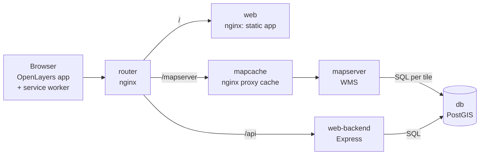

# Tech stack

What Demscore is built from and how the parts work together. This is an overview
for developers. [operations.md](operations.md) covers running the stack, and
[AGENTS.md](../AGENTS.md) has the full detail and the rules for changing it.

## In one paragraph

Demscore turns tables of democracy indicators (V-Dem, QoG, REPDEM) into a world
map of hexagons. The data, the country boundaries and the hexagon meshes are
kept in PostgreSQL with PostGIS. MapServer renders the map as WMS image tiles by
calling a SQL function, and an nginx cache can sit in front of it. A small
Express API serves everything apart from the tiles: the variable lists, the
legend breaks, the table view and the credits. The browser app is plain
JavaScript and OpenLayers, built with webpack. The whole stack runs under
`podman compose`, and `./deploy.sh` is the one way to drive it.

## Components

| Component | Technology | Role |
| --- | --- | --- |
| `router` | nginx 1.30 | The only published port (`DEMSCORE_ROUTER_PORT`, default 8090). Sends `/api` and `/healthz` to `web-backend`, `/mapserver` to `mapcache`, and everything else to `web` |
| `web` | nginx 1.30 | Serves the built web app (`webapp/dist`) and each module's `codebook.pdf` at `/codebooks/<module>/codebook.pdf` |
| `web-backend` | Node 24, Express, `pg` | JSON API for everything except the map tiles (`web-backend/server.js`) |
| `mapcache` | nginx 1.30 | Proxy in front of MapServer. Caches tiles when `DEMSCORE_ENABLE_MAPCACHE=1` and passes them through otherwise (`mapcache/cache-*.conf`) |
| `mapserver` | MapServer 8.6 | WMS server. Its layers call SQL in PostGIS for every tile (`mapserver/mapserver.map`) |
| `db` | PostgreSQL 16, PostGIS 3.6 | All data: indicator values, codebook metadata, boundaries, hex meshes, and the functions that score and classify them |
| `gdal` | GDAL `ogr2ogr` | Imports the GeoJSON boundary files into PostGIS during setup. Never left running |
| `tools` | Node 24, Python 3, poppler | Runs helper scripts during setup: parsing codebooks, import checks and reports, building config files. Has no network and is never left running |

`gdal` and `tools` are in the `setup` profile, so `podman compose up` does not
start them. The deploy scripts run them on demand, which means the host needs
only `bash`, `curl` and `podman`.

The router speaks plain HTTP and expects a reverse proxy in front of it to
terminate TLS. It is also where requests are limited: per-client rate limits on
`/api` and `/mapserver`, the security headers (CSP among them), and only
`/mapserver` itself, with only the WMS parameters the app uses, reaches
MapServer. `mapserver` and `web-backend` query the database as
`demscore_reader`, which can only read and has a 30-second statement timeout;
the superuser `demscore` is for the deployment scripts.

## The database

PostGIS does most of the work. The schema is `demscore`, and its tables fall
into three groups.

**Indicator data.** `variables` and `dataset_values` hold the CSV exports in
long format: one row per variable, year, country and value.
`variable_metadata` adds human-readable titles, descriptions and citations
taken from the codebook PDFs. `codebook_bibliography`, `codebook_citations` and
`codebook_source_datasets` record who the data must be credited to.

**Geography.**
- `countries` holds present-day countries from Natural Earth. It is built from
  the map-unit layer, so overseas territories do not inherit their sovereign's
  value.
- `historical_country_geometries_src` is the curated register of historical
  polygons, mostly from CShapes and historical-basemaps. Each polygon carries
  its source, licence and a confidence grade.
- `country_resolution_policy` decides which geometry each source country gets
  for which years, or records why it is deliberately not drawn.

**Hexagons.**
- `hex_mesh` holds the hexagon grid for every supported size, computed in
  advance for each country. It is cut in Equal Earth (EPSG:8857), so every
  hexagon covers the same real area. `hex_mesh_mercator` is a second mesh cut
  in Web Mercator. It is kept in place but not currently offered in the app.
- `hex_border_edges`, `hex_border_sides` and `hex_mesh_overlaps` are computed in
  advance so that drawing the outlines is a filter rather than a geometric
  dissolve.

Three SQL functions are the interface the rest of the stack calls:

- `demscore.hex_variable(...)` returns the hexagons for one dataset, variable,
  year and hex size, with each hexagon's quantile class. MapServer draws it.
- `demscore.country_scores(...)` returns one value per country for a
  variable-year. The API uses it for the legend breaks, the spoken summary and
  the table view. The table view and the picture are kept consistent because
  both read the same scores.
- `demscore.source_coverage(...)` compares what the source measured with what
  the map can draw.

The SQL that builds all of this is in `sql/`: `historical_geometry.sql`, then
`mapserver_hex_setup.sql`, then `mapserver_hex_mercator.sql`. Each file runs as
a single transaction.

## Rendering the map

The map is made of server-rendered image tiles, not vector data drawn in the
browser. For each tile, OpenLayers sends a WMS `GetMap` request with `dataset`,
`variable`, `year`, `hex_size`, and optionally `polarity` and `palette`.
MapServer checks each parameter against a strict regex, substitutes it into the
layer's `DATA` query, and PostGIS returns the hexagons inside the tile's
bounding box.

Each projection has two layers, which the client requests together. In Equal
Earth they are `hex_variable` (the coloured hexagons) and `hex_outline` (a
stroke around each area of equal colour). Countries with no value are drawn as
grey hexagons.

The colours are written once, in `webapp/src/core/palettes.js`.
`scripts/build_hex_classes.mjs` generates MapServer's class styles from it
(`mapserver/hex_classes.inc`), so the map and its legend cannot disagree.

Tiles are cached in two places:

1. **On the server**, by the `mapcache` nginx proxy cache, keyed by the query
   the router forwards. The router rebuilds that query from a fixed list of
   WMS parameters, so a tile is only ever stored under the request that drew it.
   `./deploy.sh preload` fills it and `./deploy.sh clear-map-tile-cache`
   empties it.
2. **In the browser**, by the service worker (`webapp/sw.js`). Its cache name
   includes a build ID that every map setup writes, so browsers discard their
   old tiles after an import.

Neither cache can tell when a tile's contents change under the same URL, such
as after a rebuilt mesh or a colour change. That is why setup clears the server
cache and renames the browser cache.

## The API

`web-backend/server.js` is a single Express file that talks to PostGIS through
`pg`. Its routes fall into three groups:

- **Config the client needs at startup** (`/api/config/*`): the variable list
  built from the database, with `webapp/config/variables.json` laid over it for
  presentation, plus codebook metadata, coverage strips, topics, polarity, and
  credits. Some of these are generated files under `webapp/config/`, rebuilt by
  setup.
- **Data that depends on the current map** (`/api/class-breaks`,
  `/api/map-data`, `/api/year-counts`, `/api/source-coverage`): these take the
  same dataset, variable and year as the WMS request and validate them the same
  way.
- **Base layers and health**: `/api/basemap/land`, `/api/runtime` and
  `/healthz`.

## The web app

`webapp/` is a git submodule (`humlab/demscore-web`). It has no framework: plain
JavaScript classes, OpenLayers 10 for the map, proj4 for Equal Earth, Lucide for
icons, and Mediabunny for video export. Webpack builds it into `webapp/dist`, and
`./deploy.sh start` runs that build in a throwaway `node:24-alpine` container.

- `src/DemscoreApp.js` wires the app together.
- `src/controllers/` has one controller per part of the UI: the map, the data
  summary, the table view, export, the about and credits dialog, metadata hover
  cards, and so on.
- `src/core/` has shared pieces: the backend client, projections, palettes,
  preferences, and export helpers.
- `config/` holds the JSON the backend serves, both hand-maintained and
  generated.

Because the map is an image, assistive technology cannot read it. The text
summary and the sortable table view are the accessible equivalent.
`webapp/AGENTS.md` and `ACCESSIBILITY.md` cover the client in depth.

## Getting data in

`./deploy.sh import-data` (and `install`) runs `scripts/import_data.sh`, which
works through these steps:

1. **Preflight.** `import_data_report.py` checks the CSVs and codebooks without
   changing anything.
2. **Backup** of the current data tables.
3. **Load.** `load_demscore_module_vars.sh` turns each module's `data.csv` into
   `variables` and `dataset_values` in one transaction. It decides which columns
   are numeric indicators, drops missing-value codes, and removes redundant
   duplicate variables.
4. **Codebooks.** `load_variable_metadata.sh` converts each `codebook.pdf` to
   text with `pdftotext`. `extract_variable_metadata.py` then parses the titles,
   descriptions, citations and licence terms.
5. **Map setup.** `setup_mapserver_hex_service.sh` imports the boundaries with
   `ogr2ogr` and runs the SQL in `sql/`. It then:
   - checks that every source country is either drawn or deliberately refused
     (`check_country_resolution.sh`)
   - builds the coverage strips and the credits (`build_variable_coverage.sh`,
     `build_attribution.sh`)
   - clears the tile cache
   - runs WMS smoke tests
6. **Summary**, followed by an offer to preload tiles.

If the map setup fails on the new data, the backup is restored. Each run's logs
and summary are kept in `state/imports/<run id>/`.

## Source data and licences

- `data/Demscore_Module_Vars/<MODULE>/` holds each module's `data.csv` and
  `codebook.pdf`, as exported from Demscore.
- `data/reference/` holds the boundary sources: Natural Earth (public domain),
  CShapes 2.0 and CShapes-Europe (CC BY-NC-SA 4.0), and historical-basemaps
  (GPL-3.0).

Because two of the boundary sources are non-commercial, the meshes and tiles are
licensed CC BY-NC-SA 4.0. `build_attribution.sh` fails setup if a boundary
source or an indicator dataset reaches the map without a credit. See
[LICENSE](../LICENSE) and `data/reference/README.md`.

## Where to start reading

| To change… | Start in |
| --- | --- |
| How CSVs become rows | `scripts/load_demscore_module_vars.sh` |
| Codebook parsing | `scripts/extract_variable_metadata.py` |
| Which country a source row maps to | `sql/historical_geometry.sql` (policy and registry) |
| Hexagon geometry, scoring, classes | `sql/mapserver_hex_setup.sql` |
| What a tile looks like | `mapserver/mapserver.map`, `webapp/src/core/palettes.js` |
| API responses | `web-backend/server.js` |
| The UI | `webapp/src/` and `webapp/AGENTS.md` |
| How the stack is started | `deploy.sh`, `scripts/start_services.sh`, `compose.yml` |
